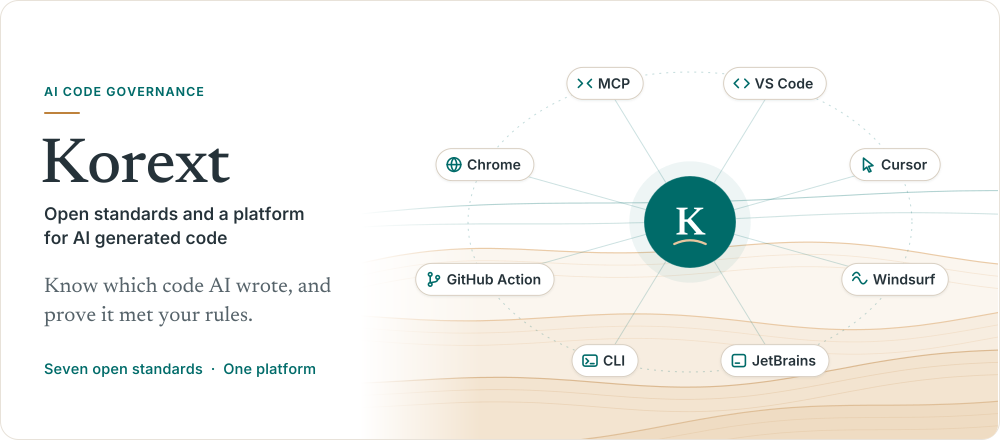
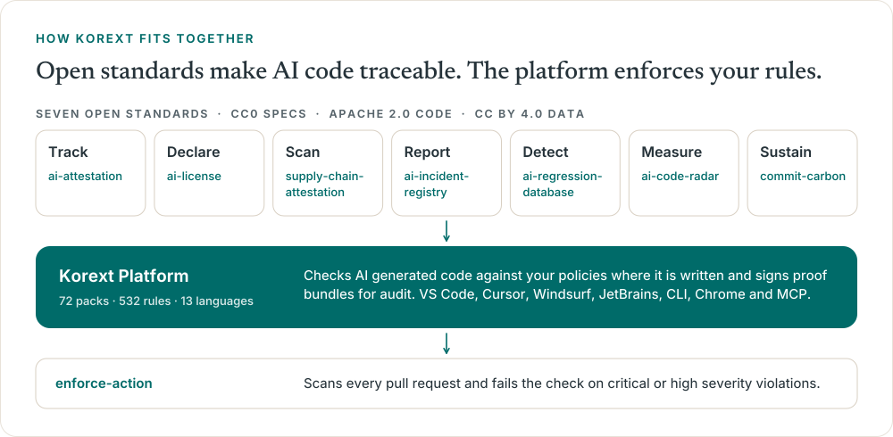

<div align="center">



<br><br>

<a href="https://korext.github.io"></a>
<a href="https://oss.korext.com"></a>
<a href="https://korext.com"></a>
<a href="https://github.com/marketplace/actions/korext-enforce"></a>
<a href="https://github.com/korext"></a>

<br><br>

<sub><b>OPEN STANDARDS</b> &nbsp;·&nbsp; <b>GOVERNANCE PLATFORM</b> &nbsp;·&nbsp; <b>SIGNED PROOF</b></sub>

<sub><a href="#why-korext">Why Korext</a> &nbsp;·&nbsp; <a href="#open-standards">Open standards</a> &nbsp;·&nbsp; <a href="#the-platform">Platform</a> &nbsp;·&nbsp; <a href="#how-it-fits-together">How it fits</a> &nbsp;·&nbsp; <a href="#licensing">Licensing</a> &nbsp;·&nbsp; <a href="#contribute">Contribute</a></sub>

</div>

<br>

## Why Korext

AI coding tools write code faster than people can review it. Every team that uses them still has to answer the same questions: which code did AI write, which tool wrote it, did it meet our rules, and can we prove it to an auditor? Korext answers them in two parts. **Seven open standards** that anyone can adopt make AI written code traceable, licensable and accountable. **The Korext Platform** checks code against your policies where it is written and signs a proof bundle for every scan.

<br>

<table>
<tr>
<td width="50%" valign="top">

<sub>01 &nbsp; OPEN SOURCE</sub>

### Korext Open Standards

Seven standards with free tools, from tracking which AI tools touched a repository to measuring the carbon cost of AI assisted commits. CC0 specifications, Apache 2.0 code, CC BY 4.0 data.

<a href="#open-standards"><b>See the standards →</b></a> &nbsp; <a href="https://oss.korext.com"><b>oss.korext.com →</b></a>

</td>
<td width="50%" valign="top">

<sub>02 &nbsp; PLATFORM</sub>

### Korext Platform

72 policy packs and 532 rules across 13 languages, in your editor, terminal, pull requests and AI assistant. Every scan produces a signed proof bundle, with processing in the US, the EU or Asia Pacific.

<a href="#the-platform"><b>See the platform →</b></a> &nbsp; <a href="https://korext.com"><b>korext.com →</b></a>

</td>
</tr>
</table>

<br>

## Open standards

<table>
<thead>
<tr><th align="left">Role</th><th align="left">Standard</th><th align="left">What it does</th><th align="left">Start with</th><th align="left">Release</th></tr>
</thead>
<tbody>
<tr>
<td><sub>TRACK</sub></td>
<td><a href="https://github.com/korext/ai-attestation"><b>ai-attestation</b></a></td>
<td>Tracks AI generated code in your repository and detects 19 AI coding tools from git history</td>
<td><code>npx @korext/ai-attestation init</code></td>
<td><a href="https://www.npmjs.com/package/@korext/ai-attestation"></a></td>
</tr>
<tr>
<td><sub>DECLARE</sub></td>
<td><a href="https://github.com/korext/ai-license"><b>ai-license</b></a></td>
<td>Declares AI provenance in any open source project with a notice that attaches to any license</td>
<td><code>npx @korext/ai-license generate</code></td>
<td><a href="https://www.npmjs.com/package/@korext/ai-license"></a></td>
</tr>
<tr>
<td><sub>SCAN</sub></td>
<td><a href="https://github.com/korext/supply-chain-attestation"><b>supply-chain-attestation</b></a></td>
<td>Finds AI provenance across your dependency tree in 14 ecosystems, with CycloneDX and SPDX output</td>
<td><code>npx @korext/supply-check scan</code></td>
<td><a href="https://www.npmjs.com/package/@korext/supply-check"></a></td>
</tr>
<tr>
<td><sub>REPORT</sub></td>
<td><a href="https://github.com/korext/ai-incident-registry"><b>ai-incident-registry</b></a></td>
<td>A public registry of AI code failures, with AICI identifiers and detection rule mapping</td>
<td><code>npx @korext/incident-report draft</code></td>
<td><a href="https://www.npmjs.com/package/@korext/incident-report"></a></td>
</tr>
<tr>
<td><sub>DETECT</sub></td>
<td><a href="https://github.com/korext/ai-regression-database"><b>ai-regression-database</b></a></td>
<td>Code patterns AI tools keep getting wrong, reproducible and linked to detection, and a scanner for your repository</td>
<td><code>npx @korext/regression-submit detect</code></td>
<td><a href="https://www.npmjs.com/package/@korext/regression-submit"></a></td>
</tr>
<tr>
<td><sub>MEASURE</sub></td>
<td><a href="https://github.com/korext/ai-code-radar"><b>ai-code-radar</b></a></td>
<td>Public data on AI code adoption across open source, with an API and embeddable charts</td>
<td><code>npm install @korext/radar-data</code></td>
<td><a href="https://www.npmjs.com/package/@korext/radar-data"></a></td>
</tr>
<tr>
<td><sub>SUSTAIN</sub></td>
<td><a href="https://github.com/korext/commit-carbon"><b>commit-carbon</b></a></td>
<td>Estimates the carbon footprint of AI assisted commits, with CSRD, SEC and CDP report formats</td>
<td><code>npx @korext/commit-carbon scan</code></td>
<td><a href="https://www.npmjs.com/package/@korext/commit-carbon"></a></td>
</tr>
</tbody>
</table>

<sub>Each standard has its own page at <a href="https://oss.korext.com">oss.korext.com</a>, with the specification, the tool and how to contribute.</sub>

<br><br>

## The platform

The Korext Platform enforces security, regulatory and engineering policies on human written and AI generated code: 72 policy packs and 532 rules across 13 languages. Each decision (pass, warn or block) comes with a signed proof bundle that records the policy version, the checks that ran, the evidence and where the code was processed, ready for an audit or an incident review.

<table>
<thead>
<tr><th align="left">Where you work</th><th align="left">How to get it</th></tr>
</thead>
<tbody>
<tr><td><b>VS Code</b></td><td><a href="https://marketplace.visualstudio.com/items?itemName=Korext.korext">Visual Studio Marketplace</a></td></tr>
<tr><td><b>Cursor and Windsurf</b></td><td><a href="https://open-vsx.org/extension/Korext/korext">Open VSX</a></td></tr>
<tr><td><b>JetBrains IDEs</b></td><td><a href="https://plugins.jetbrains.com/plugin/30716-korext">JetBrains Marketplace</a></td></tr>
<tr><td><b>Terminal</b></td><td><code>npm install -g korext</code>, then <code>korext enforce ./src</code></td></tr>
<tr><td><b>Pull requests</b></td><td><a href="https://github.com/marketplace/actions/korext-enforce">Korext Enforce</a> on GitHub Marketplace</td></tr>
<tr><td><b>Chrome</b></td><td><a href="https://chromewebstore.google.com/detail/korext-ai-code-governance/binigmpigofmlbcpacfknghdilflhccl">Chrome Web Store</a></td></tr>
<tr><td><b>AI assistants</b></td><td><a href="https://korext.com/mcp">MCP</a>, with five tools from policy directives to proof bundles</td></tr>
</tbody>
</table>

Add Korext to every pull request in one file, `.github/workflows/korext.yml`:

```yaml
name: Korext Enforcement
on: [push, pull_request]

permissions:
  contents: read
  security-events: write

jobs:
  enforce:
    runs-on: ubuntu-latest
    steps:
      - uses: actions/checkout@v4
      - uses: Korext/enforce-action@v3
        with:
          api-token: ${{ secrets.KOREXT_API_TOKEN }}
```

<sub>Violations appear as Code Scanning annotations on the pull request, and the check fails on critical or high severity findings. Without a token the action runs in anonymous mode with limited packs. Details in <a href="https://github.com/korext/enforce-action">enforce-action</a>.</sub>

<br><br>

## How it fits together

<div align="center">

</div>

<br>

## Licensing

<table>
<thead>
<tr><th align="left">Layer</th><th align="left">License</th><th align="left">Why</th></tr>
</thead>
<tbody>
<tr><td>Specifications and schemas</td><td><a href="https://creativecommons.org/publicdomain/zero/1.0/">CC0 1.0</a></td><td>Public domain, so any vendor or project can implement them</td></tr>
<tr><td>Code and tools</td><td><a href="https://www.apache.org/licenses/LICENSE-2.0">Apache 2.0</a></td><td>A permissive license with an explicit patent grant</td></tr>
<tr><td>Data and datasets</td><td><a href="https://creativecommons.org/licenses/by/4.0/">CC BY 4.0</a></td><td>Free to reuse in research and reporting, with attribution</td></tr>
</tbody>
</table>

<sub>These licenses cover the open standards. The Korext Platform is a commercial product; see <a href="https://korext.com">korext.com</a>.</sub>

<br><br>

## Contribute

Every standard welcomes contributors: a new AI tool for ai-attestation to detect, an incident for the registry, or a regression pattern. Start with the CONTRIBUTING guide in any repository, browse the <a href="https://github.com/orgs/korext/repositories">repositories</a>, or write to <a href="mailto:maintainers@korext.com">maintainers@korext.com</a> to talk about becoming a reviewer or maintainer.

<div align="center">

<br>

<a href="https://korext.github.io"></a>
<a href="https://oss.korext.com"></a>
<a href="https://korext.com"></a>
<a href="https://oss.korext.com/team"></a>
<a href="mailto:maintainers@korext.com"></a>

</div>

<br>

---

<div align="center">
<sub><i>Open standards anyone can adopt, and a platform that proves every AI change met your rules.</i></sub>
</div>
